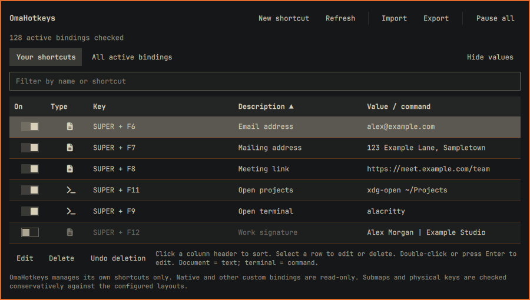

# OmaHotkeys

An Omarchy top-bar widget for managing command and text keyboard shortcuts, with
live conflict checking against native and custom Hyprland bindings. Includes a
searchable shortcut table, import/export, and persistent deletion undo.



*Screen capture using fictional shortcut names and values.*

Previously named OmaShortcuts. The internal plugin ID (`kel.omashortcuts`),
storage paths, and generated binding markers retain their original names for
compatibility. Existing shortcuts and visibility preferences need no migration.

The compact table shows an action-type icon, key combination, description, and
saved text or command. Select a row to use **Edit** or **Delete**; double-click
or press Enter to edit it. Arrow keys move between rows. A document icon marks
text actions, a terminal icon marks commands, and a keyboard icon marks
read-only active bindings.
Long cells are truncated in the list; open **Edit** to see their full contents.
Use **Hide values** to remove the **Value / command** column, or **Show values**
to restore it. The choice is saved in `~/.config/omarchy/omashortcuts/ui.ini`.
This hides values in the list only; editing still displays the stored value.
The read-only active-bindings table keeps its Submap column.

Click a column header to sort ascending; click it again to reverse the order.
The sort column and direction are saved alongside the visibility preference.
Sorting does not change binding order or the saved shortcut records.

The **On** switch enables or disables an individual shortcut without deleting it.
Disabled entries are dimmed and do not reserve their key combinations. The editor
also has an Enabled/Disabled button. Conflicting combinations can be saved
disabled for review, but enabling them requires passing the conflict check.
**Pause all** temporarily deactivates every OmaHotkeys shortcut; **Resume all**
restores the individually enabled entries after checking conflicts. These states
survive shell restarts. Native and other custom bindings are unaffected.

Click the keyboard icon, choose **New shortcut**, and enter a name, shortcut,
and an action: **Command** runs a local command; **Text** types saved text
(such as an email address) into the currently focused input when you release
the shortcut. Existing command shortcuts keep working unchanged. Use only
commands you trust. Examples of shortcut syntax: `SUPER + CTRL + F10`, `ALT + F11`,
and `XF86AudioMute`. Spell the `+` key as `plus`.

Use **Record** beside the shortcut field to capture a key combination. Held
Shift, Control, Alt, and Super keys appear in the recording hint; pressing the
final key fills the field and runs the existing conflict check. Escape or
Cancel leaves the previous shortcut unchanged. Manual entry remains available,
including for keys the recorder cannot name. The compositor may intercept an
already-bound global shortcut before the recorder receives it; enter that
combination manually to check its conflict.

Text is passed literally through stdin to `wtype`, never interpreted as a shell
command, and does not change your clipboard. Typing waits up to five seconds for
held modifiers to be released; it fails explicitly rather than typing modified
keys or guessing a delay. Concurrent text actions are rejected to prevent
interleaved input. Unicode, whitespace, and multiline
text are supported up to 2048 characters. Newlines and tabs simulate Enter and
Tab, so they may submit a form, move focus, or execute a line in a terminal.
The receiving application must accept simulated keyboard input; read-only
controls and applications that block it cannot be filled. Text is stored locally
in plain text, so do not use this feature for passwords or secrets.

Edits are checked after a short debounce and again immediately before saving.
Conflicts with native bindings, other user bindings, and enabled OmaHotkeys
bindings are rejected when activating a shortcut. Editing excludes only that
shortcut's own existing binding.
Modifier order, common aliases, and key-name case are normalized with
libxkbcommon. Bindings in submaps, release bindings, catch-all bindings, and
unresolvable keys are checked conservatively. Physical keycodes are resolved
against all levels of the configured XKB layouts; unknown physical keys block
the same modifiers rather than assuming they are safe. Mouse bindings do not
block keyboard shortcuts. These conservative checks can reject combinations
that would otherwise work. Application-internal shortcuts are not visible to
Hyprland and cannot be checked.

OmaHotkeys owns only its generated file, never rewrites native/custom bindings,
and uses Omarchy's `o.bind` helper. Changes reload Hyprland, check configuration
errors, verify the bindings were applied, and restore the previous files on
failure. A revision check prevents stale windows from overwriting newer edits.
Refresh to see changes made in another window or outside the plugin.

## Deleting and undoing shortcuts

In **Your shortcuts**, select a row, click **Delete** below the table, then
**Confirm delete**. Native and other custom bindings in **All active bindings**
are read-only.

**Undo deletion** appears beside the editing/deletion buttons whenever a deleted
shortcut can be restored. Only the most recent deletion can be undone, including
after restarting the shell or computer. A newer deletion replaces the previous
undo record; other edits, imports, and pause changes preserve it.

Undo restores the original shortcut, identifier, and individual enabled state.
If an enabled shortcut now conflicts with another binding, it is restored
**disabled**, with a message identifying the conflict. Global pause remains
unchanged. A successful undo consumes the record; failed restoration keeps it
available. Storage limits and required runtime tools still apply.

The deleted shortcut's full text/command is retained locally in plain text for
undo, and automatic backups may also retain it. Exports include only current
shortcuts, not the deleted undo record.

## Import, export, and backups

**Export** lets you select a destination with **Browse**, or enter a full local
JSON file path inside the widget. Choosing a location does not write the file;
the plain-text warning must still be confirmed. It includes all shortcuts, their individual
enabled states, and full text/command values, even when values are hidden in the
table. Files are created with owner-only permissions. An explicitly selected
existing destination is replaced after confirmation; managed configuration and
plugin files cannot be overwritten.

**Import** lets you **Browse** for a JSON file in any accessible folder, or enter
its full local path (including `~/` paths). Selecting a file does not import it;
preview how many shortcuts will be added or skipped, then confirm. Confirmation
appends new entries **disabled for review**, with new identifiers; existing
shortcuts are never replaced. Identical type/key/name/value entries are skipped,
regardless of their identifier or enabled state. Review imported commands before
enabling them. Conflicting imported keys can remain disabled until resolved.
Files changed after preview must be previewed again.

Imports accept OmaHotkeys exports (`format: "OmaHotkeys"`, `version: 1`,
`shortcuts: [...]`) and the existing version-1 internal JSON format. Global pause
and table preferences are not imported or exported. Imports and stored state are
limited to 1 MiB and 200 shortcuts.

Before each configuration change, the previous JSON is saved privately in
`~/.config/omarchy/omashortcuts/backups/`. The latest ten automatic backups are
retained; they contain the same plain-text values as exports. To recover entries,
import a backup and review/enable the restored disabled entries. This adds missing
or changed entries rather than replacing the current configuration.

## Installation

Requires an Omarchy installation using the Quickshell bar and Lua Hyprland
configuration, Python 3, `hyprctl`, and `libxkbcommon.so.0`. Text actions also
require `wtype` (normally preinstalled by Omarchy); missing support is reported
instead of saving a nonworking text shortcut. Typing errors produce a desktop
notification and a diagnostic in the session logs.
If needed, install text input support with `omarchy pkg add wtype`.
The import/export **Browse** buttons use `zenity` for native Open/Save dialogs.
If missing, install it with `omarchy pkg add zenity`; manual paths remain available.

### First installation

**One-time manual setup is required before enabling the widget.** Installing the
repository does not install dependencies, create shortcut data, or modify your
Hyprland configuration. Plugins run unsandboxed with your user permissions;
review the source before trusting it.

1. Install the Git-managed repository:
   ```bash
   omarchy plugin add https://github.com/kelmankenberg/OmaHotkeys.git
   ```
   Confirm the installation after reviewing the source, but answer **No** when
   asked to enable it. Complete the following setup first. Omarchy installs it
   at `~/.config/omarchy/plugins/kel.omashortcuts`.
2. Locate your configuration directory and create the required directories:
   ```bash
   config_dir="${XDG_CONFIG_HOME:-$HOME/.config}"
   mkdir -p "$config_dir/omarchy/omashortcuts" "$config_dir/hypr"
   ```
   The file paths in the next steps are relative to this configuration directory
   (`~/.config` by default).
3. If `omarchy/omashortcuts/shortcuts.json` does not exist, create it containing:
   ```json
   {"version": 1, "shortcuts": []}
   ```
   If `hypr/omashortcuts.lua` does not exist, create it containing this line and
   a trailing newline:
   ```lua
   -- Generated by OmaShortcuts. Manage these bindings in the bar widget.
   ```
   **Never replace existing files with these empty examples.** Keep existing
   shortcuts and generated Lua unchanged; use the recovery instructions below
   if those files disagree.
4. Back up your existing `hypr/hyprland.lua`, then add this line **once** at its
   end. Skip this step if the same loader is already present:
   ```lua
   dofile((os.getenv("XDG_CONFIG_HOME") or (os.getenv("HOME") .. "/.config")) .. "/hypr/omashortcuts.lua")
   ```
   Do not replace your main Hyprland configuration or remove other bindings.
5. Apply the loader and check for errors:
   ```bash
   hyprctl reload
   hyprctl configerrors
   ```
   Resolve any errors before proceeding.
6. Discover and enable the widget:
   ```bash
   omarchy-shell shell rescanPlugins
   omarchy plugin enable kel.omashortcuts --section right
   ```
   Click its keyboard icon in the top bar. The shortcut list starts empty on a
   new installation; create a command or text shortcut to begin.

### Updates and existing installations

For a Git-managed installation, review and apply updates with:

```bash
omarchy plugin update kel.omashortcuts
```

Omarchy shows the Git changes and asks for confirmation before updating. Updates
replace plugin code, not the separate shortcut data or table preferences. Do not
repeat the empty-file initialization during an update.

If you installed by copying files, the updater cannot pull changes until that
plugin directory is migrated to a Git checkout. `omarchy plugin add` refuses an
already-installed plugin ID; do not delete or overwrite your existing shortcut
data to work around that check.

### Recovery

User data lives outside the plugin directory, so saving a shortcut does not
hot-reload the entire shell. After initial setup, do not hand-edit the JSON or
generated Lua file.
If they disagree after an interrupted save, stop editing in the widget,
back up both files, and regenerate the Lua from the JSON:

```bash
python3 - <<'PY'
import importlib.util
import json
from pathlib import Path
import os
spec = importlib.util.spec_from_file_location(
    "shortcuts", Path.home() / ".config/omarchy/plugins/kel.omashortcuts/bin/shortcuts.py"
)
module = importlib.util.module_from_spec(spec)
spec.loader.exec_module(module)
config = Path(os.environ.get("XDG_CONFIG_HOME") or Path.home() / ".config")
payload = json.loads((config / "omarchy/omashortcuts/shortcuts.json").read_text())
rows = payload["shortcuts"]
store = module.Store(config)
for row in rows:
    store.check_row(row)
module.atomic_write(config / "hypr/omashortcuts.lua", module.render(rows, payload.get("paused", False)))
PY
hyprctl reload
hyprctl configerrors
```

### Uninstall

1. Disable the widget with `omarchy plugin disable kel.omashortcuts`.
2. Remove only the OmaHotkeys `dofile` line added above from your main
   `hypr/hyprland.lua`.
3. Run `hyprctl reload` and `hyprctl configerrors`. Removing the loader and
   reloading deactivates the managed shortcuts; disabling the widget alone
   does not deactivate their Hyprland bindings.
4. Remove the plugin checkout with `omarchy plugin remove kel.omashortcuts`.

Shortcut data, preferences, backups, and the generated Lua file remain outside
the plugin directory. Keep them if you want to reinstall.

## Planned for future versions

These features are planned but not yet implemented:

- Categories or tags for organizing shortcuts.
- Application-specific shortcuts.
- Duplicate an existing shortcut as a starting point.
- Text templates with date/time and reusable variables.
- Safe previews of text expansions and command details before execution.
- Richer conflict details identifying a binding's source.
- Resizable columns and saved table layouts.

## Development

English strings use the Omarchy translation API and fall back to English when
another language is selected. All names, commands, and diagnostic text render
as plain text; the plugin makes no network requests.

```bash
python3 -m unittest discover -s tests -v
qmllint BarWidget.qml PlainText.qml ShortcutTable.qml ShortcutKeys.js TableSort.js
node tests/test_shortcut_keys.js
node tests/test_table_sort.js
```

## License

Released under the [MIT License](LICENSE).
